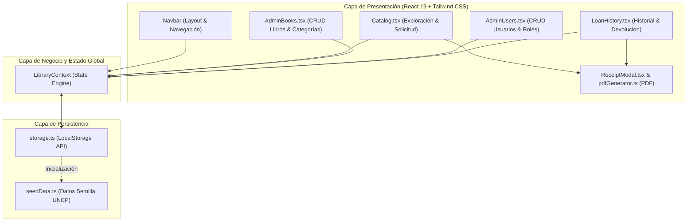
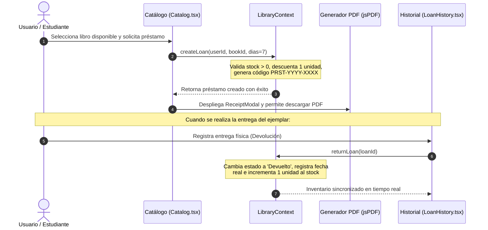

# 📚 Sistema de Gestión de Biblioteca Universitaria — UNCP

<div align="center">


**Universidad Nacional del Centro del Perú**  
**Facultad de Ingeniería de Sistemas**  
*Desarrollo de Aplicaciones Web — 9no Semestre (2026)*  
**Docente:** Dr. Jaime Suasnábar Terrel · **Evaluación Parcial**

</div>

---

## 👥 Equipo de Desarrollo e Integrantes

Este proyecto fue desarrollado de manera colaborativa por el equipo de estudiantes del 9no semestre de Ingeniería de Sistemas, siguiendo una metodología de integración continua basada en ramas de trabajo (*feature branches*), Pull Requests y revisión de código (*Code Review*).

| # | Integrante | Código Universitario / Correo | Rol Principal en el Proyecto |
|---|---|---|---|
| 1 | **Aaron Ccente Rojas** | `aronccente@gmail.com` | **Frontend Lead & UI/UX Specialist** · Módulo de Usuarios, Refinamiento Visual y QA |
| 2 | **José Osorio Mallqui** | `clasesvirtualez96@gmail.com` | **Software Architect & Core State** · Arquitectura Base, Storage, Modelos y Context API |
| 3 | **Jesús Huaricallo Jaime** | `e_2021200787j@uncp.edu.pe` | **Fullstack Feature Developer** · Catálogo, Préstamos, Generador PDF e Historial |
| 4 | **Arlette Suarez Roman** | `e_2022200427L@uncp.edu.pe` | **Module Specialist & Data Integrity** · Módulo de Libros y Categorías (CRUD e Inventario) |

---

## 🛠️ Desglose de Aportes y Responsabilidades Individuales

### 1. Aaron Ccente Rojas
* **Módulo Asignado:** Módulo 2 — Administración de Usuarios (`src/pages/AdminUsers.tsx`), Layout Institucional (`src/components/layout/Navbar.tsx`) y Estandarización de Estilos (`src/index.css`).
* **Aportes y Funcionalidades Desarrolladas:**
  - Implementó el **CRUD completo de usuarios** del sistema universitario, con clasificación por roles (`Estudiante` y `Docente`).
  - Desarrolló validaciones en cliente para códigos universitarios únicos, formato de correo electrónico y campos obligatorios.
  - Implementó la regla de integridad de negocio que **impide eliminar usuarios que posean préstamos activos pendientes**.
  - Diseñó y construyó la barra de navegación superior (`Navbar.tsx`) con responsive design, accesibilidad, navegación activa y selector de usuario.
  - Estandarizó la **paleta de colores y tokens visuales de la aplicación**, modernizando los estilos a una estética limpia, sobria y de alto contraste con Tailwind CSS v4.
  - Gestión del repositorio: revisión, integración y fusión de los Pull Requests (`PR #1`, `PR #2`, `PR #3`, `PR #4`, `PR #5`) garantizando la cohesión del sistema.
* **Trazabilidad Git:** Commits `0b16010`, `205d428`, `441114d`, `9d90f43` y gestión de PRs #2, #4 y #5.

---

### 2. José Osorio Mallqui
* **Módulo Asignado:** Arquitectura del Sistema, Estado Global (`src/context/LibraryContext.tsx`), Servicios de Persistencia (`src/services/storage.ts`), Modelos (`src/types/index.ts`) y Componentes Base.
* **Aportes y Funcionalidades Desarrolladas:**
  - Inicializó y configuró el entorno del proyecto con **React 19, TypeScript, Vite y Tailwind CSS v4**.
  - Modeló los tipos de dominio TypeScript (`Book`, `Category`, `User`, `Loan`, `LoanStatus`, `UserType`).
  - Diseñó la capa de persistencia offline en **LocalStorage** con serialización segura, manejo de errores y generador secuencial de códigos de préstamo (`PRST-YYYY-XXXX`).
  - Creó la carga inicial de datos semilla institucionales (`seedData.ts`) con información representativa de facultades, autores, libros de ingeniería y usuarios de prueba.
  - Diseñó e implementó el **Context API central (`LibraryContext.tsx`)**, encapsulando la lógica de negocio y las operaciones inmutables de todo el ciclo de vida bibliotecario.
  - Construyó componentes base reutilizables de UI: `Badge.tsx` y `Modal.tsx`.
* **Trazabilidad Git:** Commits `6cf17d0` (T001) y `6e40305` (T002).

---

### 3. Jesús Huaricallo Jaime
* **Módulo Asignado:** Módulo 3 — Catálogo Público y Préstamos (`src/pages/Catalog.tsx`), Módulo 4 — Comprobantes PDF (`src/utils/pdfGenerator.ts`, `src/components/common/loans/ReceiptModal.tsx`) y Módulo 5 — Historial y Devoluciones (`src/pages/LoanHistory.tsx`).
* **Aportes y Funcionalidades Desarrolladas:**
  - Diseñó el **Catálogo interactivo en cuadrícula (grid)** para estudiantes y docentes, integrando búsqueda predictiva por texto (título, autor, ISBN), filtros por categoría y selector de disponibilidad inmediata.
  - Desarrolló el flujo modal de **solicitud y registro de préstamos**, vinculando al usuario preseleccionado, calculando fechas límites automáticas (7 días por defecto) y descontando stock en tiempo real con validación estricta de stock cero.
  - Implementó el motor de **generación de comprobantes digitales descargables en PDF** mediante `jspdf`, maquetando un documento formal en formato A5 con membrete oficial de la UNCP, código único, datos del solicitante y condiciones del préstamo.
  - Construyó el modal de confirmación y vista previa de recibo (`ReceiptModal.tsx`).
  - Implementó el **Historial de Préstamos y Devolución**, con filtros por estado (`Activo`, `Devuelto`, `Vencido`), cálculo de vencimiento en caliente y acción de devolución con retorno automático de stock al inventario.
* **Trazabilidad Git:** Commit `9fe3b9a` y Pull Request #3.

---

### 4. Arlette Suarez Roman
* **Módulo Asignado:** Módulo 1 — Gestión de Catálogo Bibliográfico y Categorías (`src/pages/AdminBooks.tsx`).
* **Aportes y Funcionalidades Desarrolladas:**
  - Diseñó y construyó la interfaz de administración bibliográfica con sistema de pestañas para alternar fluidamente entre **Inventario de Libros** y **Categorías Temáticas**.
  - Implementó el formulario y modal para el registro y edición de libros (título, autor, ISBN, categoría y stock numérico inicial).
  - Desarrolló validaciones de integridad para evitar registros con ISBN duplicados, valores negativos de stock o campos en blanco.
  - Implementó la administración completa de categorías (alta, edición y baja) con validación estricta de dependencias referenciales (impide eliminar categorías que contengan libros registrados).
  - Programó la eliminación segura de libros, validando que no se puedan eliminar ejemplares que cuenten con préstamos activos en curso.
  - Añadió indicadores visuales de stock (agotado, stock bajo y disponible) y mensajes reactivos de confirmación y error.
* **Trazabilidad Git:** Commit `2dd2860` y Pull Request #1.

---

## 🏛️ Arquitectura y Flujo de la Aplicación



### Flujo de Transacción de Préstamo y Devolución



---

## 📋 Módulos y Reglas de Negocio Implementadas

### Módulo 1: Gestión de Categorías y Libros (`/admin/libros`)
- **Gestión de Libros:** Alta, edición y baja de títulos con ISBN, autor, categoría y cantidad de ejemplares.
- **Gestión de Categorías:** Clasificación por áreas de conocimiento de la Facultad de Ingeniería de Sistemas (Sistemas, Computación, Bases de Datos, Desarrollo Web).
- **Reglas de Integridad:**
  - No se permiten duplicados en el código ISBN.
  - No se permite stock menor a cero.
  - Bloqueo de eliminación de libros asociados a préstamos activos.
  - Bloqueo de eliminación de categorías con libros asociados.

### Módulo 2: Gestión de Usuarios (`/admin/usuarios`)
- **Roles:** Soporte para usuarios `Estudiante` y `Docente`.
- **Datos obligatorios:** Nombres, apellidos, código universitario y correo institucional `@uncp.edu.pe`.
- **Reglas de Integridad:**
  - Código universitario único en el sistema.
  - Bloqueo de eliminación si el usuario mantiene libros prestados en estado `Activo`.
  - Mecanismo para definir el usuario activo en sesión para realizar operaciones rápidas de préstamo.

### Módulo 3: Catálogo Interactivo y Solicitud de Préstamos (`/`)
- **Búsqueda Dinámica:** Búsqueda en vivo por palabras clave en título, autor o ISBN.
- **Filtros Combinados:** Filtrado por categoría temática y conmutador para ver exclusivamente libros con disponibilidad inmediata.
- **Validación de Inventario:** El botón de préstamo se desactiva y alerta si el stock es `0`. Al confirmar la solicitud, el stock se descuenta inmediatamente.

### Módulo 4: Emisión de Comprobantes Digitales en PDF
- **Generación en Cliente:** Generación del archivo en tiempo de ejecución sin dependencias de backend mediante `jspdf`.
- **Estructura Oficial:** Formato media cuartilla (A5) con membrete institucional de la UNCP, código alfanumérico único (`PRST-YYYY-XXXX`), detalle completo del libro, usuario y fecha límite de devolución.

### Módulo 5: Historial y Devolución de Préstamos (`/historial`)
- **Control de Estados:**
  - `Activo`: Préstamo vigente dentro del periodo de préstamo.
  - `Vencido`: Préstamo activo cuya fecha límite es anterior a la fecha actual.
  - `Devuelto`: Ejemplar retornado a biblioteca.
- **Acción de Devolución:** Marca el préstamo como completado y reincorpora automáticamente +1 unidad al inventario del libro correspondiente.
- **Re-impresión:** Posibilidad de descargar el comprobante en PDF en cualquier momento desde el historial.

---

## 💻 Stack Tecnológico

| Herramienta | Versión | Propósito |
|---|---|---|
| **React** | `19.2.8` | Biblioteca base para interfaces de usuario declarativas y reactivas |
| **TypeScript** | `6.0.2` | Tipado estático estricto y contratos de dominio |
| **Vite** | `8.3.0` | Bundler y servidor de desarrollo ultrarrápido con HMR |
| **Tailwind CSS** | `4.3.3` | Framework de diseño utilitario para estilos modernos y responsivos |
| **React Router** | `7.18.4` | Enrutamiento SPA del lado del cliente con navegación declarativa |
| **jsPDF** | `4.2.1` | Motor de generación de documentos y comprobantes en formato PDF |
| **Lucide React** | `1.55.0` | Paquete de iconografía vectorial ligera y accesible |
| **Oxlint** | `1.81.0` | Linter de alto rendimiento en Rust para detección de buenas prácticas |

---

## 📁 Estructura del Proyecto

```
parcial/
├── public/
│   ├── favicon.svg            # Favicon institucional
│   ├── icons.svg              # Íconos SVG
│   └── logo-uncp.png          # Escudo oficial de la UNCP
├── src/
│   ├── assets/                # Recursos estáticos e imágenes
│   ├── components/
│   │   ├── common/
│   │   │   ├── loans/
│   │   │   │   └── ReceiptModal.tsx   # Modal de vista previa y descarga de comprobante
│   │   │   ├── Badge.tsx              # Componente reutilizable de insignias de estado
│   │   │   └── Modal.tsx              # Componente modal accesible con overlay y animaciones
│   │   └── layout/
│   │       └── Navbar.tsx             # Barra superior con enlaces institucionales y usuario activo
│   ├── context/
│   │   └── LibraryContext.tsx         # Estado global (Context API) y orquestación de negocio
│   ├── data/
│   │   └── seedData.ts                # Semillas de datos iniciales (libros, categorías, usuarios)
│   ├── pages/
│   │   ├── AdminBooks.tsx             # Módulo 1: CRUD de Libros y Categorías
│   │   ├── AdminUsers.tsx             # Módulo 2: CRUD de Usuarios y Roles
│   │   ├── Catalog.tsx                # Módulo 3: Catálogo público y solicitud de préstamos
│   │   └── LoanHistory.tsx            # Módulo 5: Historial de préstamos y devoluciones
│   ├── services/
│   │   └── storage.ts                 # Servicio de serialización y persistencia en LocalStorage
│   ├── types/
│   │   └── index.ts                   # Interfaces y tipos de dominio TypeScript
│   ├── utils/
│   │   └── pdfGenerator.ts            # Módulo 4: Generador de comprobantes PDF con jsPDF
│   ├── App.tsx                        # Componente raíz y definición de rutas del sistema
│   ├── index.css                      # Configuración de Tailwind CSS y tokens de diseño
│   └── main.tsx                       # Punto de entrada de la aplicación React
├── .gitignore                         # Reglas de exclusión de Git
├── .oxlintrc.json                     # Configuración del linter Oxlint
├── index.html                         # Plantilla HTML con metadatos institucionales
├── package.json                       # Manifiesto del proyecto y scripts
├── tsconfig.json                      # Configuración principal de TypeScript
└── vite.config.ts                     # Configuración de empaquetado Vite
```

---

## 🚀 Guía de Instalación y Ejecución Local

### Prerrequisitos
- **Node.js** (versión 18 o superior recomendada)
- **npm** o **pnpm** instalado en el sistema

### Pasos de Instalación

1. **Clonar el repositorio:**
   ```bash
   git clone https://github.com/Desarrollo-web-9no/parcial.git
   cd parcial
   ```

2. **Instalar dependencias:**
   ```bash
   npm install
   ```

3. **Iniciar el servidor de desarrollo:**
   ```bash
   npm run dev
   ```
   *La aplicación estará disponible de inmediato en `http://localhost:5173`.*

4. **Ejecutar el linter de código:**
   ```bash
   npm run lint
   ```

5. **Construir para producción:**
   ```bash
   npm run build
   ```

---

## 🎯 Criterios de Evaluación y Calidad Cumplidos

- [x] **Arquitectura Limpia:** Separación clara entre capas de presentación, estado de la aplicación, utilidades y servicios de almacenamiento.
- [x] **Persistencia Fiable:** Todos los cambios en libros, categorías, usuarios y transacciones persisten en `localStorage` ante recargas de página.
- [x] **Control de Concurrencia e Inventario:** El stock se descuenta atómicamente al prestar y se reintegra al devolver.
- [x] **Comprobantes Oficiales:** Emisión de PDFs formateados con folio único para respaldo del estudiante.
- [x] **Diseño Responsivo e Institucional:** Interfaz adaptable a pantallas de escritorio, tabletas y dispositivos móviles bajo estándares de usabilidad y accesibilidad.
- [x] **Historial Trazable:** Integración completa de los 4 miembros del equipo mediante Git y GitHub.

---

<div align="center">
  <sub>Facultad de Ingeniería de Sistemas · Universidad Nacional del Centro del Perú · 2026</sub>
</div>
